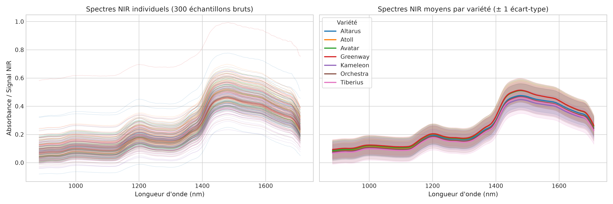
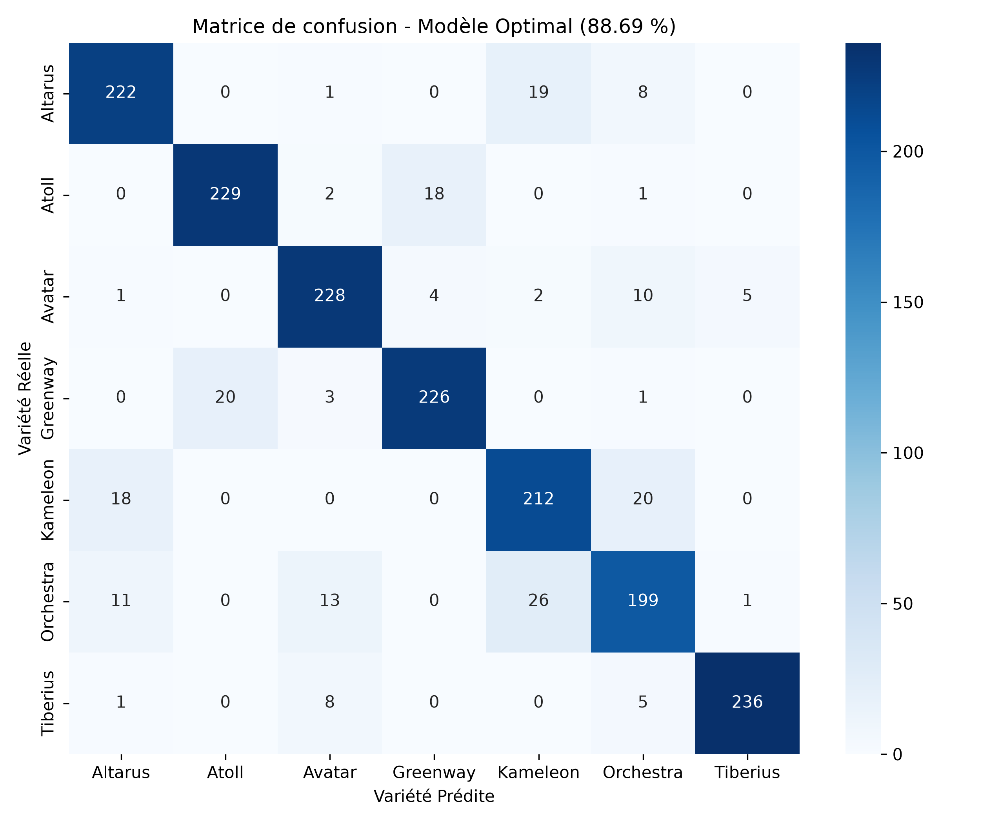

# Projet Chimiométrie 2027 🌱

**Cours :** MARO-200 — Research Project on Algorithms for Data Science  
**Université :** Université de Mons (UMons)  
**Data Challenge :** [Chimiométrie 2027](https://chemom2027.sciencesconf.org/resource/page/id/16) (Société Française de Statistique — SFDS)  
**Auteurs :** Abdelouahad ALLA & Marcos FUNEZ FAMOSO  

---

## 📌 Objectif du Défi

Prédire la variété de pois parmi **7 catégories** (*Altarus, Atoll, Avatar, Greenway, Kameleon, Orchestra, Tiberius*) à partir de données multimodales :
- **Spectres proche infrarouge (NIR)** : 512 longueurs d'onde (884.25 – 1709.70 nm)
- **Mesures morphologiques** : longueur, largeur, épaisseur, volume
- **Composantes couleur** : CIELAB ($L, a^*, b^*$)

- **Jeu d'entraînement (Calibration)** : 1 750 pois étiquetés (250 par variété, parfaitement équilibrés).
- **Jeu de test (Prédiction)** : 700 pois anonymes à classifier.
- **Métrique d'évaluation officielle** : **Taux de bonne classification** (Accuracy, %).

---

## 📊 Résultats & Performances (Validation Croisée Stratifiée 5-Fold)

| Modèle & Configuration | Modalités | Prétraitements & Fusion | Accuracy CV (5-Fold) | Écart-type ($\pm$) |
| :--- | :--- | :--- | :---: | :---: |
| **Ensemble Soft-Voting (Modèle Soumis)** | **Toutes** | **Block Scaling + Soft-Voting (SVM RBF + Lin + ExtraTrees)** | **88.69 %** | **$\pm$ 1.06 %** |
| SVM RBF Optimisé ($C=50, \gamma=0.05$) | Toutes | SNV + Savitzky-Golay 1d + Frobenius Block Scaling | **88.40 %** | $\pm$ 1.15 % |
| SVM RBF ($C=10, \gamma=\text{scale}$) | Toutes | SNV + Savitzky-Golay 1d + Frobenius Block Scaling | **86.11 %** | $\pm$ 1.73 % |
| SVM Linéaire ($C=1$) | Toutes | SNV + Savitzky-Golay 1d + Frobenius Block Scaling | **85.31 %** | $\pm$ 0.29 % |
| SO-PLS (22 LV NIR + 5 LV Phys) | Toutes | Sequential & Orthogonalized PLS | **81.26 %** | $\pm$ 1.95 % |
| *Baseline Marcos (Holdout 20%)* | *Toutes* | *StandardScaler global (sans chimiométrie)* | *78.86 %* | — |
| *Baseline Marcos (5-Fold CV)* | *Toutes* | *StandardScaler global (sans chimiométrie)* | *77.94 %* | $\pm$ 1.22 % |
| PLS-DA (20 Latent Variables) | NIR seul | SNV + Savitzky-Golay 1ère dérivée | **76.74 %** | $\pm$ 2.10 % |
| Random Forest (300 arbres) | NIR seul | SNV + Savitzky-Golay 1ère dérivée | 71.60 % | $\pm$ 2.60 % |
| SVM RBF | Morpho + Couleur | StandardScaler | 52.74 % | $\pm$ 3.44 % |
| SVM RBF | Couleur seule | StandardScaler ($a^*$ discrimine Atoll & Greenway) | 49.43 % | $\pm$ 1.90 % |
| SVM Linéaire | NIR brut seul | Aucun (Spectres bruts) | 31.60 % | $\pm$ 1.50 % |

---

## 📈 Visualisations des Résultats

### Profils Spectres NIR (Bruts vs Moyens par Variété)


### Matrice de Confusion du Modèle Optimal (88.69 % d'Accuracy)


---

## 📁 Structure du Dépôt

```
projet_chimiometrie_2027/
│
├── data/
│   ├── Calibration_set_challenge.xlsx   # 1 750 pois étiquetés (train)
│   ├── Prediction_set_challenge.xlsx    # 700 pois non étiquetés (test)
│   └── My_contribution.xlsx             # Fichier de soumission complété avec les 700 prédictions
│
├── figures/                             # Figures scientifiques & résultats
│   ├── fig1_nir_raw_spectra.png
│   ├── fig2_morphology_distributions.png
│   ├── fig3_color_distributions.png
│   ├── fig4_batch_distribution.png
│   ├── fig5_pca_nir.png
│   ├── fig6_pca_morpho_color.png
│   ├── fig7_correlation_matrix.png
│   ├── fig9_confusion_matrix_optimal.png
│   └── benchmark_results.csv
│
├── src/                                 # Code source Python modulaire
│   ├── preprocessing.py                 # SNV, Savitzky-Golay, Block Scaling, nettoyage
│   ├── eda.py                           # Analyse exploratoire et génération des figures
│   ├── models.py                        # Benchmark complet (SVM, PLS-DA, RF, fusion)
│   ├── optimize_and_predict.py          # Tuning fin et génération des prédictions finales
│   └── sopls.py                         # Algorithme multivoie SO-PLS
│
├── requirements.txt                     # Dépendances Python
└── README.md
```

---

## ⚙️ Installation & Reproduction

```bash
# 1. Cloner le dépôt
git clone https://github.com/abdelou/Projet-Chimiom-trie-2027.git
cd Projet-Chimiom-trie-2027

# 2. Créer l'environnement virtuel et installer les dépendances
python3 -m venv venv
source venv/bin/activate
pip install -r requirements.txt

# 3. Lancer l'analyse exploratoire et générer les graphiques
python src/eda.py

# 4. Lancer le benchmark comparatif
python src/models.py

# 5. Optimiser et générer les prédictions finales dans My_contribution.xlsx
python src/optimize_and_predict.py

# 6. Exécuter le modèle multivoie SO-PLS
python src/sopls.py
```

---

## 👥 Équipe

- **Abdelouahad ALLA** (`abdelouahad.alla@student.umons.ac.be`)
- **Marcos FUNEZ FAMOSO** (`Marcos.FUNEZFAMOSO@student.umons.ac.be`)  
*Université de Mons (UMons)*
